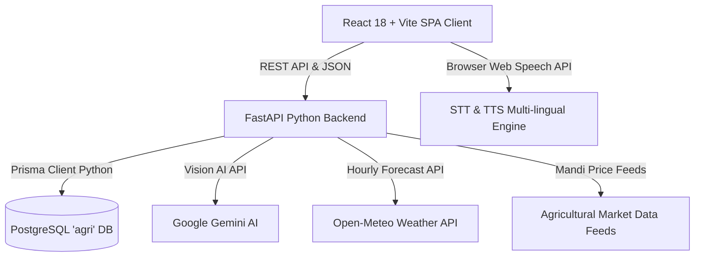

# 🌱 Bharath Krishi — AI-Powered Agriculture Partner
> **Digital Public Good for Indian Smallholder Farmers & Agritech Ecosystem**

[](https://fastapi.tiangolo.com)
[](https://react.dev)
[](https://vitejs.dev)
[](https://www.postgresql.org)
[](https://prisma.io)
[](LICENSE)

Bharath Krishi is a comprehensive agricultural intelligence web platform designed to empower smallholder farmers across India. It bridges critical information gaps by providing AI plant pathology diagnostics, dynamic government subsidy matching, scientific ICAR-based NPK fertilizer calculators, live APMC mandi wholesale rates, and micro-climate spraying advisories with multi-lingual audio synthesis.

---

## 🚀 Key Modules & Capabilities

### 1. 🏛️ Government Schemes & Subsidy Eligibility Finder
- **Real-Time Dynamic Matching**: Automatically re-evaluates qualifying welfare schemes as soon as landholding size, unit, crop, or state changes (no button submission required).
- **Comprehensive Benefit Calculations**: Evaluates potential direct benefits (e.g. ₹3,09,850+ on 2 Guntas up to ₹4,18,000+ on 5 Acres), covering:
  - **PM-KISAN DBT**: ₹6,000/yr direct income support.
  - **PMKSY (PDMC)**: Up to 55% capital subsidy for drip & sprinkler micro-irrigation.
  - **PMFBY**: Comprehensive crop risk coverage and yield insurance with 90%+ subsidized premium.
  - **SMAM Machinery**: 40% to 50% subsidy on tractors, tillers, and drone sprayers.
  - **Kisan Credit Card (KCC)**: 4% concessional interest crop loans.
  - **PM-KUSUM**: 60% capital grant for standalone solar irrigation pumps.
  - **PKVY**: ₹50,000/ha organic farming input assistance.
  - **Soil Health Card**: 100% free 12-parameter diagnostic testing.
- **Farmer Tier Categorization**: Automatically classifies land into Marginal (< 1 Ha / 2.5 Ac), Small (1–2 Ha), Semi-Medium (2–4 Ha), and Large (> 4 Ha).
- **1-Tap Quick Acreage Chips**: Instant size selection (`0.5 Ac`, `1 Ac`, `2 Ac`, `5 Ac`, `10 Ac`, `2 Guntas`, `10 Guntas`).

### 2. 🔬 AI Crop Health & Plant Pathology Diagnostics
- **Visual Disease Detection**: Powered by Google Gemini Vision to diagnose fungal, bacterial, viral, and pest damages from leaf images.
- **Actionable Remediation**: Delivers targeted regenerative bio-controls, chemical treatments, and preventive agronomic practices.

### 3. 🧪 Precision Fertilizer & NPK Dosage Calculator
- **ICAR POP Formulations**: Calculates exact commercial bag counts (Urea 45kg, DAP 50kg, MOP 50kg) tailored to crop growth stages (Basal, Vegetative, Flowering, Fruiting).
- **Acreage Adjustments**: Adapts dynamically across units (`Acres`, `Guntas`, `Hectares`, `Bighas`).
- **Organic Alternatives**: Formulates required Farmyard Manure (FYM) and Vermicompost quantities.

### 4. 📈 Nearest APMC Mandi Wholesale Rates
- **Live Market Rates**: Real-time modal wholesale prices across agricultural APMC yards in India.
- **Voice & GPS Search**: Automatic district geo-location and voice search input for hands-free lookup.

### 5. ⛅ Micro-Climate Weather & Spray Advisory
- **Hourly Suitability Windows**: Open-Meteo satellite weather telemetry computing safe spraying intervals.
- **Risk Analysis**: 6-hour rain wash-off hazard probabilities and wind drift velocity warnings.

### 6. 🌐 10 Regional Indian Languages & Voice Assistance
- Integrated speech synthesis and speech recognition for **Kannada, Telugu, Tamil, Hindi, Marathi, Bengali, Malayalam, Gujarati, Punjabi, and Odia**.
- Audio speaker guidance designed for farmers with low textual literacy.

### 7. 🛡️ Administrator Portal & Central Farmer Registry
- Dedicated protected route (`/admin`) backed by PostgreSQL database records.
- Farmer registry telemetry displaying geographic GPS coordinates, preferred regional languages, and registration timestamps.

---

## 🏗️ Architecture & Tech Stack



| Layer | Technologies |
| :--- | :--- |
| **Frontend** | React 18, Vite, Lucide React, Modern Vanilla CSS Design System |
| **Backend** | FastAPI, Python 3.11+, Pydantic v2, Uvicorn (ASGI) |
| **Database & ORM** | PostgreSQL 15+, Prisma ORM (Python Client) |
| **AI & External APIs** | Google Gemini Vision, Open-Meteo Weather API, Web Speech API |

---

## 📁 Repository Structure

```
bharath-digital-project/
├── backend/
│   ├── app/
│   │   ├── routes/             # REST endpoints (schemes, farmers, mandi, weather, diagnose)
│   │   ├── schemas/            # Pydantic v2 request/response validation models
│   │   ├── services/           # Business logic, scheme rules engine, fertilizer formulas
│   │   └── utils/              # Database connections & Gemini clients
│   ├── prisma/
│   │   └── schema.prisma       # PostgreSQL models (GovScheme, Farmer, SavedPlan, etc.)
│   ├── main.py                 # FastAPI application entrypoint with lifespan startup tasks
│   ├── requirements.txt        # Python pip dependencies
│   ├── .env.example            # Environment configuration template
│   └── venv/                   # Python virtual environment (ignored)
│
├── frontend/
│   ├── src/
│   │   ├── App.jsx             # Main interactive application with tab routing
│   │   ├── index.css           # Modern design system, HSL color tokens, animations
│   │   ├── main.jsx            # React root mount
│   │   └── assets/             # SVG icons and visual assets
│   ├── package.json            # Vite & React scripts and dependencies
│   └── index.html              # HTML5 entrypoint
│
├── .gitignore                  # Git ignore rules for node_modules, .env, venv, etc.
└── README.md                   # Project documentation
```

---

### ☁️ Method A: Microsoft Azure Cloud Deployment (Production)

For complete instructions on deploying to **Microsoft Azure** (Azure Container Apps, Azure App Service, and Azure Database for PostgreSQL Flexible Server), see the detailed guide:
👉 **[Microsoft Azure Deployment Guide (AZURE_DEPLOYMENT_GUIDE.md)](AZURE_DEPLOYMENT_GUIDE.md)**

Includes:
- **Azure Web App for Containers**: 1-click deployment via Azure Portal using Docker Compose.
- **Azure Container Apps**: Automated Bicep template (`deploy/azure-resources.bicep`).
- **GitHub Actions CI/CD**: Automatic build & deploy on every push (`.github/workflows/azure-deploy.yml`).

---

### 🐳 Method B: 1-Command Local Docker Deployment

The easiest way to run the entire system locally (PostgreSQL Database, FastAPI Backend, and React Nginx Frontend) is with Docker Compose:

1. **Clone the repository**:
   ```bash
   git clone https://github.com/MehaboobS/ai-powered-agri-patner.git
   cd ai-powered-agri-patner
   ```

2. **(Optional) Configure Environment**:
   ```bash
   cp .env.docker.example .env
   ```
   *Optionally add your `GEMINI_API_KEY` for AI crop leaf disease diagnostics.*

3. **Build and launch all containers**:
   ```bash
   docker compose up --build
   ```

4. **Access your services**:
   - 🌐 **Web App**: `http://localhost:5173` (or `http://localhost`)
   - 🚀 **FastAPI Interactive Docs**: `http://localhost:8000/docs`
   - 🐘 **PostgreSQL Database**: `localhost:5432` (db: `agri`, user: `postgres`, pass: `postgres`)

5. **Stop containers**:
   ```bash
   docker compose down
   ```

---

### 💻 Method C: Manual Local Setup (Without Docker)
1. Navigate to the backend directory:
   ```bash
   cd backend
   ```
2. Create and activate a Python virtual environment:
   ```bash
   python -m venv venv
   # On Windows:
   venv\Scripts\activate
   # On macOS/Linux:
   source venv/bin/activate
   ```
3. Install dependencies:
   ```bash
   pip install -r requirements.txt
   ```
4. Configure environment variables:
   ```bash
   cp .env.example .env
   ```
   *Edit `.env` to provide your `DATABASE_URL` and optional `GEMINI_API_KEY`.*
5. Push database schema and generate Prisma client:
   ```bash
   prisma db push
   prisma generate
   ```
6. Start the FastAPI development server:
   ```bash
   uvicorn main:app --reload --port 8000
   ```
   *The interactive Swagger API documentation is accessible at `http://localhost:8000/docs`.*

---

### Step 3: Frontend Setup
1. Open a new terminal and navigate to the frontend directory:
   ```bash
   cd frontend
   ```
2. Install npm dependencies:
   ```bash
   npm install
   ```
3. Run the development server:
   ```bash
   npm run dev
   ```
4. Access the web application at `http://localhost:5173`.

---

## 🔒 Security & Industry Standards

- **Secret Isolation**: All credentials, database connection strings, and API keys are stored in environment variables (`.env`) and excluded from version control via `.gitignore`.
- **Database Migrations**: Declarative schema management using Prisma ORM with relational integrity.
- **Input Validation**: Strict request/response validation using Pydantic v2 schemas.
- **CORS Protection**: Scoped CORS middleware allowing communication only from authorized origin URLs.

---

## 🤝 Contributing

Contributions are welcome! Please follow these steps:
1. Fork the repository.
2. Create your feature branch (`git checkout -b feature/NewFeature`).
3. Commit your changes (`git commit -m 'Add NewFeature'`).
4. Push to the branch (`git push origin feature/NewFeature`).
5. Open a Pull Request.

---

## 📄 License

This project is licensed under the MIT License — see the [LICENSE](LICENSE) file for details.
